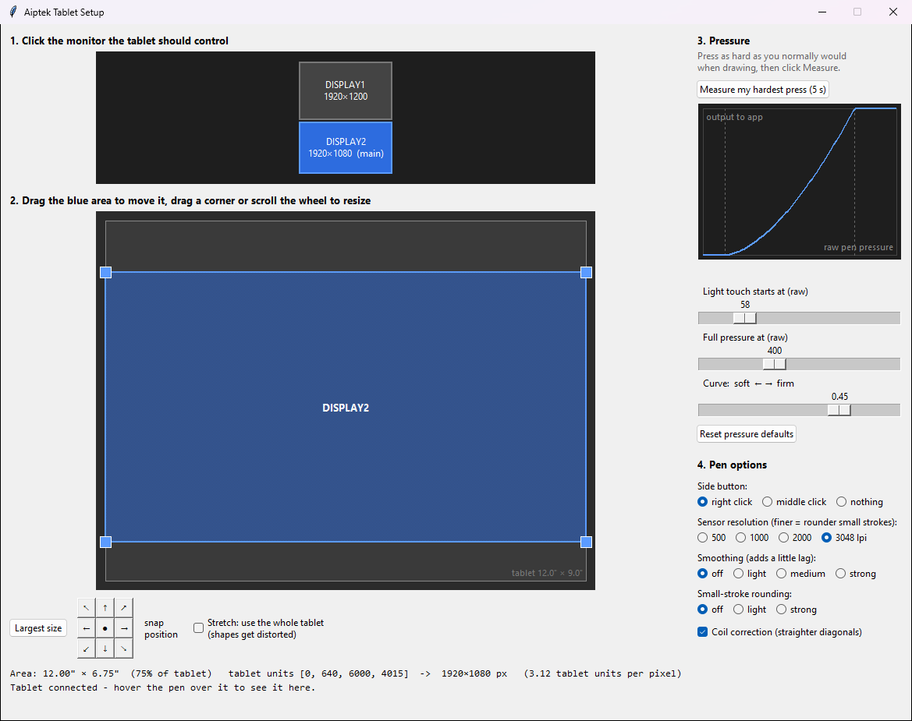

# Aiptek HyperPen tablet driver for Windows 10/11

A small, open-source driver that brings the **Aiptek HyperPen 12000U** (and probably its siblings, see
[compatibility](docs/COMPATIBILITY.md)) back to life on modern Windows. Aiptek's last drivers were for
Windows XP/Vista; on Windows 10/11 the tablet only works as a *relative* mouse. With this driver:

* the pen is **absolute**: where you touch the tablet is where the cursor goes;
* **pressure** works (as a Windows Ink pen) in Clip Studio Paint, Krita, Photoshop, OneNote, Paint, ...;
* you choose the **monitor** and the **part of the tablet** to use, so shapes keep their proportions;
* pressure range and curve are **calibrated to your hand**;
* it reads the sensor at up to **3048 lpi** (older drivers used 500 lpi), so small strokes stay round;
* there is a correction for this tablet's wavy diagonals.

No kernel driver and no third-party driver: it uses Microsoft's built-in WinUSB driver and runs as a small tray app.

<p align="center"><b><a href="../../releases/latest">⬇ Download AiptekTablet.exe (latest release)</a></b></p>

<p align="center"></p>

## Install

1. Plug in the tablet.
2. Run **`AiptekTablet.exe`** and click **Install**.
   * SmartScreen may show *"Windows protected your PC"* because the exe isn't code-signed:
     click **More info → Run anyway**.
3. Approve the **administrator prompt** (once). The tablet is switched to Microsoft's *WinUSB* driver so
   Windows stops treating it as a mouse.
4. A tablet icon appears in the tray next to the clock. Click it to open **Settings**.

That's all: no Python or other software is needed. The app installs to `%LOCALAPPDATA%\Programs\AiptekTablet`
(no admin rights needed for that part) and starts when you sign in (you can turn that off in the tray menu).

## Settings

| Setting | What it does |
|---|---|
| **Monitor** | Click the screen the tablet controls. Monitor layouts with screens above or left of the main one are handled. |
| **Tablet area** | Drag the blue rectangle to move it; drag a corner or scroll to resize. It keeps the monitor's shape so circles stay round. *Largest size* and the arrow buttons snap it. *Stretch* uses the whole tablet (distorted on widescreens). |
| **Pressure** | *Measure my hardest press*, then press as hard as you normally draw for 5 s. *Light touch starts at* and *Curve* (soft ↔ firm) fine-tune it; the graph shows what apps receive. |
| **Pen side button** | Right click (default), middle click or nothing. |
| **Coil correction** | Removes the HyperPen 12000U's small regular ripple on diagonal lines (on by default). |
| **Sensor resolution** | 3048 lpi (default) reads the pen six times finer than the 500 lpi older drivers used, so small strokes and tiny circles stay round. |
| **Small-stroke rounding** | Optional: fills in the firmware's per-axis "sticking" on very slow, tiny strokes. Off by default. |
| **Smoothing** | Optional adaptive filter. Adds a little lag; usually not needed. |

Changes apply immediately while you draw. Settings are stored in `%APPDATA%\AiptekTablet\config.json`.

## Drawing apps

The pen is delivered through **Windows Ink** (Windows' pointer input), not Wintab. In apps that let you
choose, pick Windows Ink:

* **Clip Studio Paint**: *File → Preferences → Tablet → Tablet service: **TabletPC*** (it often defaults to
  Wintab, which gives no pressure).
* **Krita**: *Settings → Configure Krita → Tablet settings → **Windows 8+ Pointer Input***.
* **Photoshop**: Windows Ink is the default. If you've disabled it via `PSUserConfig.txt`, re-enable it.
* **Paint, OneNote, Whiteboard, Fresh Paint, Edge** work out of the box.

More in [Troubleshooting](docs/TROUBLESHOOTING.md).

## Uninstall

*Settings → Apps → Installed apps → Aiptek HyperPen 12000U Tablet Driver → Uninstall*, or tray menu →
*Uninstall...*. The tablet is given back to Windows' own driver (a relative mouse again), and the app, its
settings and its startup entry are removed.

## Documentation

* [Troubleshooting & known caveats](docs/TROUBLESHOOTING.md)
* [Compatible tablets](docs/COMPATIBILITY.md)
* [How it works: protocol and Windows details](docs/HOW_IT_WORKS.md)
* [Developer tools](tools/README.md) (reverse engineering and calibration scripts)

## Building from source

Python 3.12 is needed on the build machine only.

```
python -m pip install pyinstaller pystray pillow
powershell -ExecutionPolicy Bypass -File build.ps1
```

The result is `dist\AiptekTablet.exe`. To run from source without building:

| Command | |
|---|---|
| `python app.py` | tray app (as installed) |
| `python aiptek_driver.py [--verbose]` | driver in a console |
| `python aiptek_setup.py` | settings window |
| `python winusb_install.py --list \| --install \| --restore` | show / switch the tablet's Windows driver (asks for admin) |

| File | Purpose |
|---|---|
| `app.py` | tray app, self-installer, uninstaller |
| `aiptek_driver.py` | the driver: protocol, mapping, pressure, coil correction, pen injection |
| `aiptek_setup.py` | settings window |
| `tablet_io.py` | WinUSB / HID access to the tablet, supported USB IDs |
| `winusb_install.py` | switches the tablet between WinUSB and Windows' HID driver |
| `hidwin.py` | ctypes bindings for SetupAPI and hid.dll |

## Credits

The tablet's command protocol comes from the Linux kernel's
[`aiptek` driver](https://github.com/torvalds/linux/blob/master/drivers/input/tablet/aiptek.c)
and the [aiptektablet project](https://aiptektablet.sourceforge.net/). License: [MIT](LICENSE).
